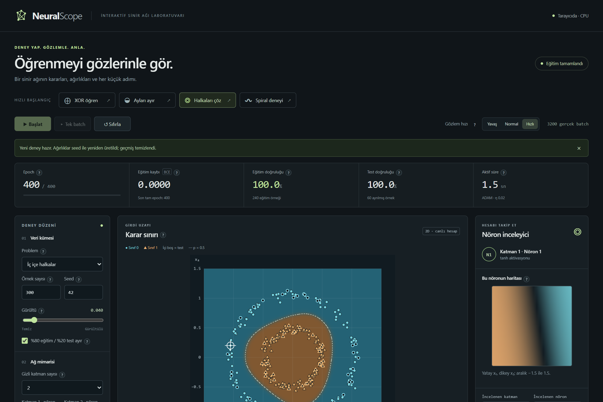
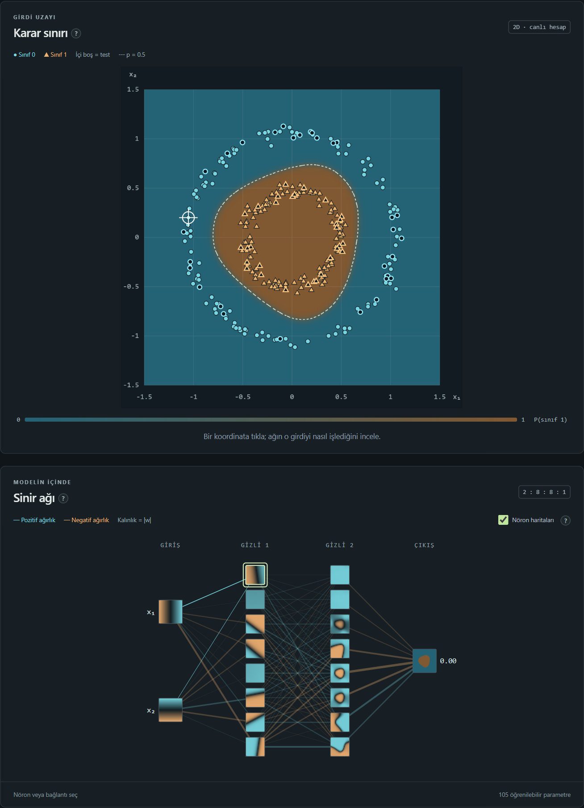

# NeuralScope

> **English:** An interactive neural network lab that runs entirely in the browser. A small network is written from scratch in TypeScript (backpropagation, SGD, Adam) and you watch it learn in real time. The interface is in Turkish. Setup: `npm ci`, then `npm run dev`.

Sinir ağlarının gerçekten nasıl öğrendiğini gösteren Türkçe, etkileşimli bir laboratuvar. Küçük bir ağ, kütüphane kullanmadan TypeScript ile yazılmıştır; karar sınırı, ağırlıklar, türevler ve metrikler aynı gerçek modelden gelir. Eğitim tarayıcının CPU'sunda yapılır. Hesap açma, API anahtarı, Python veya GPU gerekmez.



## Özellikler

- **Canlı eğitim:** başlat, duraklat, tek batch ilerlet, sıfırla. Beş veri kümesi ve dört hazır deney.
- **Nöron haritaları:** her nöronun girdi düzleminde neye tepki verdiğini görürsün. İlk katmanların düz geçişleri, sonraki katmanlarda eğri şekillere dönüşür.
- **Nöron inceleyici:** seçili nöronun ileri geçişini, türevlerini ve son batch güncellemesini gerçek sayılarla takip et.
- **Önceki deneyle karşılaştırma:** bir ayarı değiştirince eski eğitim eğrisi grafikte gri çizgi olarak kalır, neyin değiştiği üstte yazar.
- **Kendi çizimin:** karar sınırına tıklayarak kendi veri setini oluştur.
- **Zamanda geri sarma:** kaydırıcıyla geçmiş bir epoch'a dön veya öğrenmeyi baştan oynat.
- **Ek girdi özellikleri:** x₁², x₂², x₁·x₂ ve sin dönüşümlerini aç, kapat. Gizli katman sayısı 0 da olabilir.
- **Kayıt:** ayarları veya eğitilmiş ağırlıkları JSON olarak indirip geri yükle, epoch geçmişini CSV olarak al.
- **Bağlam içi yardım:** ayar, metrik ve panellerin yanındaki **?** düğmesi kısa bir açıklama açar.



## Kurulum

Node.js **22.12 veya üzeri** gerekir.

```sh
npm ci
npm run dev
```

Uygulama **http://127.0.0.1:5173** adresinde açılır; port doluysa Vite sonrakini seçer. `index.html` dosyasını doğrudan açmak modül ve Worker kısıtları nedeniyle çalışmaz.

| Komut             | Ne yapar                                             |
| ----------------- | ---------------------------------------------------- |
| `npm run dev`     | Geliştirme sunucusunu başlatır                       |
| `npm test`        | Matematik, eğitim ve dosya testlerini çalıştırır     |
| `npm run build`   | TypeScript kontrolü yapar ve `dist` klasörünü üretir |
| `npm run preview` | Derlenmiş `dist` klasörünü yerel sunucuda açar       |
| `npm run lint`    | ESLint ile kodu denetler                             |
| `npm run format`  | Prettier ile kodu biçimlendirir                      |

## İlk deney

1. Açılışta XOR hazırdır. **▶ Başlat**'a bas; arka plan rengi ağın her noktadaki "sınıf 1" olasılığını, kesikli çizgi karar sınırını gösterir.
2. Eğitim bitince kaydırıcıyla başa sar ve sınırın nasıl oluştuğunu izle.
3. Soldan öğrenme hızını değiştirip yeniden eğit; eski eğri gri çizgi olarak kalır.
4. **Halkaları çöz** deneyini seç, gizli katmanı 0 yap: ağ düz bir sınırla halkaları ayıramaz. x₁² ve x₂² girdilerini açınca aynı ağ problemi çözer.

## Matematik

- **Model:** seçilen 1–7 girdi özelliği, 0–3 gizli katman, katman başına 2–16 nöron, tek sigmoid çıkış. Gizli aktivasyon tanh, ReLU veya sigmoid.
- **Başlangıç:** ReLU katmanlarında He normal, diğerlerinde Xavier normal; bias sıfır. Veri, ağırlık ve karıştırma bağımsız seed'li rastgele akışlar kullanır, sonuçlar tekrarlanabilir.
- **Kayıp:** BCE doğrudan logit'ten hesaplanır: `max(z,0) - y*z + log1p(exp(-abs(z)))`. Bu, `log(0)` ve taşma sorununu önler.
- **Geri yayılım:** çıkışta `dL/dz = sigmoid(z) - y`; gizli katmanlarda zincir kuralı. Gradyan gerçek batch uzunluğuna göre ortalanır. L2 yalnızca ağırlıklara uygulanır, grafiklerdeki BCE cezasızdır.
- **Optimizer:** SGD ve Adam (beta1=0.9, beta2=0.999, bias düzeltmeli).
- **Metrikler:** her epoch sonunda tam eğitim ve test kümelerinden yeniden hesaplanır. Test noktaları hiçbir batch'e girmez.

Gradyanlar testlerde merkezi farkla (`h=1e-5`, hata `<2e-6`) tüm ağırlık ve bias'lar için doğrulanır.

## Kod düzeni

```text
src/
  ml/          Model, optimizer, veri, girdi özellikleri, eğitim döngüsü (arayüzden bağımsız)
  workers/     Eğitimi ana thread dışında çalıştıran Web Worker
  hooks/       Worker ile arayüz arasındaki köprü
  components/  Kontroller, karar sınırı, ağ, grafikler, inceleyici, zaman çizelgesi
  utils/       JSON ve CSV dosyaları
tests/         Vitest testleri
```

Model ağırlıkları Worker'da yaşar, arayüz yalnızca kopyalarını okur. Isı haritası ve nöron haritaları da Worker'da hesaplandığı için eğitim sayfayı kilitlemez.

## Sınırlar

Bu, 2 boyutlu ikili sınıflandırma için bir eğitim aracıdır; her seed, gürültü veya mimari için öğrenme garantisi yoktur. Nokta sayısı 2.000, epoch sayısı 5.000 ile sınırlıdır. Geri sarma için en fazla yaklaşık 300 epoch'un ağırlıkları saklanır. Model dosyası optimizer belleğini içermez. NaN veya aşırı büyük değerler görünür bir hata üretir, gradyan gizlice kırpılmaz. Arayüz testleri otomatik değildir; testler matematik, eğitim ve dosya katmanını kapsar.
